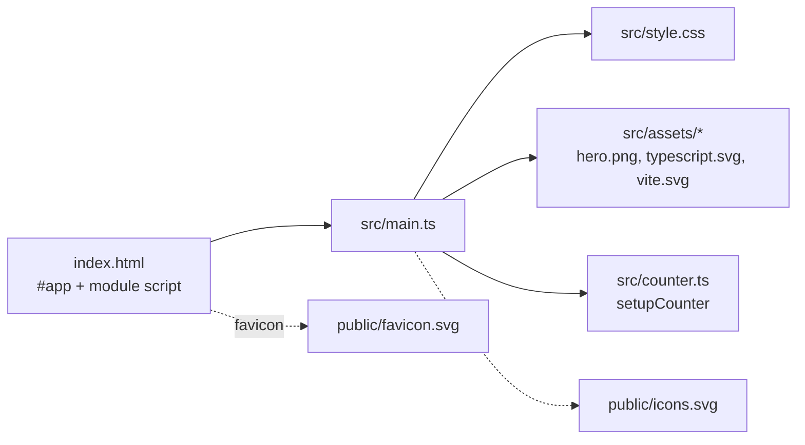

# Browser page shell

The deployable unit is a single-page Vite app with no framework.

## Behavior

- `index.html` provides `
` and loads `/src/main.ts` as an ES module.
- `src/main.ts` imports the stylesheet and image assets (Vite resolves them to URLs), then replaces
  `#app`'s `innerHTML` with a static template: a hero section, a counter button, and
  documentation/social link sections.
- Icons in the template reference SVG symbols in `public/icons.svg` by fragment
  (`/icons.svg#<name>-icon`); files in `public/` are served from the site root unprocessed.
- `setupCounter(button)` in `src/counter.ts` keeps a closure-local count, renders
  `Count is N`, and increments on click. State is in-memory only.

## Styling

`src/style.css` defines design tokens as CSS custom properties on `:root` (text, background, border,
accent, shadow, font stacks), overrides them under `prefers-color-scheme: dark`, and reduces the
base font size below 1024px width.

## Boundaries

The page shell does not use the [binary search](../search/binary-search.md) module.
